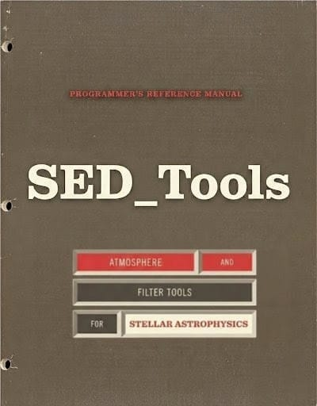
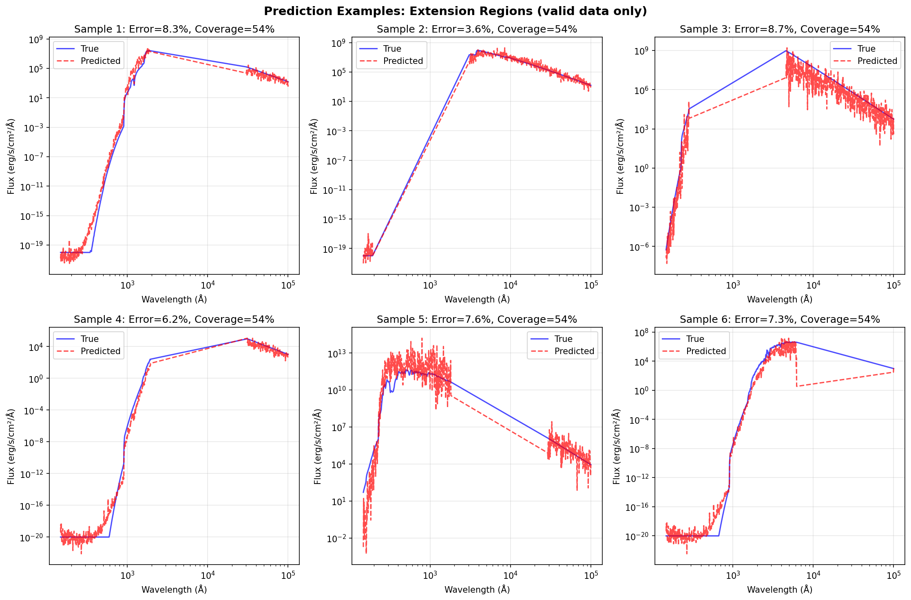
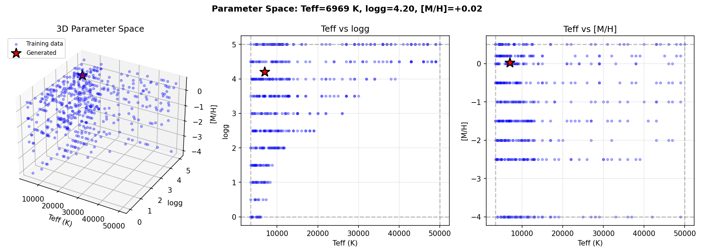
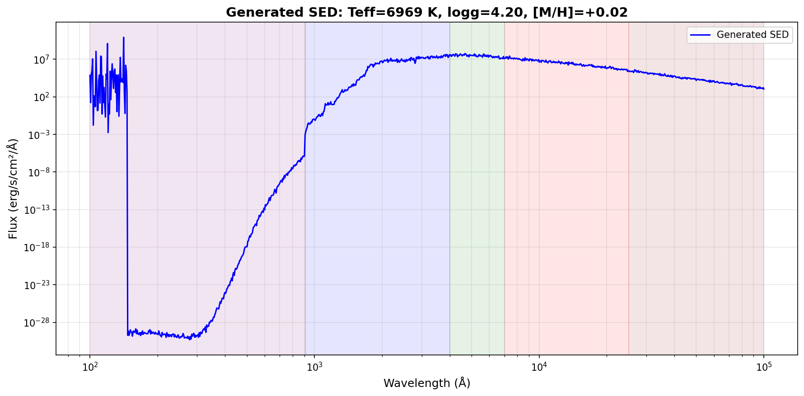

<p align="center">
  
</p>

<h1 align="center">SED_Tools</h1>

<p align="center">
  <strong>Download, process, and standardize stellar spectral grids for SED_Model and MESA</strong>
</p>

<p align="center">
  <a href="https://github.com/nialljmiller/SED_Tools/actions/workflows/tests.yml"></a>
</p>

<p align="center">
  <a href="#installation">Installation</a> •
  <a href="#quick-start">Quick Start</a> •
  <a href="#cli-reference">CLI Reference</a> •
  <a href="#python-api">Python API</a> •
  <a href="#data-sources">Data Sources</a>
</p>

---

## Overview

SED_Tools is a Python package for working with stellar spectral energy distributions (SEDs). It provides unified access to multiple stellar spectral grids, standardizes spectral data to consistent units, and generates output files compatible with [MESA](https://docs.mesastar.org/)'s `colors` module, [SED_Model](https://github.com/nialljmiller/SED_Model) and other codes.

### Key Features

- **Multi-source downloads** — Fetch model spectra from SVO, MSG, MAST (BOSZ), and NJM mirror
- **Photometric filters** — Download transmission curves from the NJM mirror with SVO Filter Profile Service fallback
- **Optical path components** — Track which parts of the atmosphere, telescope/instrument optics, filter and detector QE are included in a passband; compose available factors for the same instrument and site
- **Detector-aware photometry** — Record photon- or energy-counting response conventions and use the corresponding integration weights for synthetic photometry
- **Unit standardization** — Convert all spectra to consistent units (wavelength in Å, flux in erg/cm²/s/Å)
- **External integration** — Generate binary flux cubes, HDF5 bundles, and lookup tables. This is for [SED_Model](https://github.com/nialljmiller/SED_Model) and [MESA](https://docs.mesastar.org/)'s `colors` module
- **Grid combination** — Merge multiple stellar spectral grids into unified "omni grids"
- **ML completion** — Extend incomplete SEDs to broader wavelength ranges using neural networks
- **ML generation** — Create complete SEDs from stellar parameters (Teff, logg, [M/H]) using neural networks

### Terminology

A **stellar spectral grid** is a collection of **model spectra** indexed by
parameters such as effective temperature, surface gravity and metallicity.
We use **spectral grids** in menus and commands. **Spectral libraries** is
the broader term when discussing collections that also include observed
templates, planetary spectra or stellar population spectra.

Use `sed-tools grids` and `--grids` to discover and download spectral grids.
The earlier `spectra` command and `--models` option remain supported aliases.
In Python, `SpectralGrid`, `SpectralGridInfo`, `sed.grid`, `sed.available_grids()`
and `find_grids` are the preferred names; `Catalog`, `CatalogInfo`, `sed.cat`,
`sed.available_models()` and `find_atmospheres` remain compatible. Existing keyword arguments such as
`catalog` and `model_root`, and the `stellar_models/` storage directory,
retain their established names.

Earth's **atmosphere transmission models**, used in ground-based optical
paths, are separate from stellar spectral grids.

---

## Installation

### From PyPI

```bash
pip install sed-tools
```

### From Source

```bash
git clone https://github.com/nialljmiller/SED_Tools.git
cd SED_Tools
pip install .
```

### Development Install

```bash
pip install -e .
```

### Requirements

- Python ≥ 3.10
- numpy, pandas, h5py, astropy, matplotlib
- PyTorch (required for ML completer and generator)

See `pyproject.toml` for the complete dependency list.

---

## Quick Start

### Interactive Mode

Launch the interactive menu:

```bash
sed-tools
```

### Direct Commands

```bash
# Download photometric filter transmission curves
sed-tools filters

# Combine installed filter sets
sed-tools filters-combine Gaia2MASS GAIA/GAIA 2MASS/2MASS

# Download model spectra
sed-tools grids

# Build flux cubes and lookup tables from downloaded spectra
sed-tools rebuild

# Combine multiple grids into a unified ensemble
sed-tools combine

# Train or apply the ML SED completer (extends existing spectra)
sed-tools ml_completer

# Train or apply the ML SED generator (creates SEDs from parameters)
sed-tools ml_generator

# Fill coarse Teff gaps in a flux cube to reduce interpolation stair-stepping
sed-tools densify --flux-cube data/stellar_models/tmap2/flux_cube.bin \
                  --output data/stellar_models/tmap2_dense/flux_cube.bin \
                  --teff-spacing 1000

# Ingest an external grid of .txt spectra into the pipeline
sed-tools import --path /path/to/spectra/ --name MyGrid

# Report parameter-space coverage of an installed grid
sed-tools coverage --grids Kurucz2003all

# Show or set the data directory
sed-tools config
sed-tools config --set /path/to/data --move
```

---

## CLI Reference

### `sed-tools filters`

Download photometric filter transmission curves interactively. The browser merges the SVO Filter Profile Service catalogue with the NJM mirror: facilities that exist on SVO are listed first, and any facilities available **only** on the NJM mirror are surfaced alongside them (marked `[NJM]`). Filters are fetched from the NJM mirror when available (fastest), with automatic fallback to SVO for everything else.

```bash
# Interactive facility/instrument/filter selection
sed-tools filters
```

Enter a single facility number to browse its instruments. Enter several numbers
or ranges, such as `1,3,5-7`, to download every instrument for those facilities
directly, without instrument selection or component prompts.

**Output structure:**

```
data/filters/Generic/Johnson/
├── B.dat           # Filter transmission curve
├── V.dat
├── R.dat
└── Johnson         # Index file for MESA
```

Downloaded filter sets can be combined without rebuilding spectra or flux cubes, because a filter set is only a directory of ``*.dat`` curves plus the MESA index file whose lines list those curves. The helper below copies the selected curves into a new instrument folder and writes the matching index file automatically.

```bash
# Create data/filters/Combined/Gaia2MASS/ with a Gaia2MASS index file
sed-tools filters-combine Gaia2MASS GAIA/GAIA 2MASS/2MASS

# Pick custom MESA-facing labels and fail on duplicate band names
sed-tools filters-combine optical_ir Generic/Johnson 2MASS/2MASS \
  --facility Custom --instrument optical_ir --on-conflict error
```

The same operation is available from Python:

```python
from sed_tools.api import Filters

combined = Filters.combine("Gaia2MASS", "GAIA/GAIA", "2MASS/2MASS")
print(combined)
```

#### Understanding the optical path and detector response

SED_Tools now describes a passband in terms of the elements along the light's path: the site's atmosphere (for ground-based observations), telescope and instrument optics, the bandpass filter, and the detector's quantum efficiency (QE). This makes it possible to inspect what a published transmission curve already includes before choosing which components to use in synthetic photometry.

Two separate pieces of metadata describe the response:

| Metadata | What it tells you |
|---|---|
| `Components` | Which physical throughput factors are already multiplied into the curve: `filter`, `optics`, `qe`, `atmosphere`, or a source's unresolved `instrument` contribution |
| `DetectorType` | Whether photometric integration uses the energy-counting weight `T(λ)` or photon-counting weight `T(λ)·λ` |

QE describes the detector's wavelength-dependent efficiency; detector type describes how the response is weighted during integration. Tracking both prevents counting a throughput factor twice or applying the wrong detector weighting. Component availability depends on what the source publishes: a total throughput does not imply that all of its factors can be recovered separately. Unknown contents and assumed detector types remain identified as such in the metadata.

#### Photon- vs energy-counting detectors

A transmission curve is defined either for an energy-counting detector (e.g. Bessell's Johnson–Cousins curves) or for a photon-counting one (CCDs, e.g. Gaia DR3, JWST, 2MASS). Synthetic photometry weights the integrand by `T(λ)` in the first case and by `T(λ)·λ` in the second ([Bessell & Murphy 2012](https://ui.adsabs.harvard.edu/abs/2012PASP..124..140B/abstract), eq. A9); using the wrong one shifts Gaia G by ~0.035 mag.

Every filter file records which applies on its column-name row, the one line MESA discards before reading samples:

```
Wavelength,Transmission,FilterID=GAIA/GAIA3.G;DetectorType=photon;DetectorTypeSource=svo;WavelengthUnit=Angstrom
3200.0,2.37366962e-08
...
```

The metadata is a third CSV field with no whitespace (`%`, spaces, tabs, line breaks, `,`, `;`, `"` and `#` in values are percent-escaped, e.g. `Atmosphere=site=ctio_des%20airmass=1.2`). Released MESA, pandas, `csv`, `np.loadtxt(skiprows=1)` and astropy's csv reader therefore see the same `Wavelength` and `Transmission` columns and samples as before; a curve without metadata keeps the bare `Wavelength,Transmission` row. Readers that require exactly two header names, such as `np.genfromtxt(names=True)`, see the extra field.

SED_Tools 0.3.0 wrote these fields as `#` lines above the column row instead, which released MESA (25.12.1, 26.4.1) misreads as extra samples. SED_Tools still reads such files, and moves their fields onto the column row whenever it fetches a cached set, downloads, tags or combines them. The NJM mirror has been converted.

A curve with no column-name row (its first line is a sample) has no free line, so SED_Tools leaves it as it is and stores no metadata in it.

`DetectorType` is `energy` or `photon`. `DetectorTypeSource` is `svo` (taken from the SVO record for `FilterID`), `svo-curve-match` (the file was identified by matching its curve point-by-point against SVO), or `assumed` (not identifiable — custom curves — written as `energy` and unverified). Downloads write the header automatically; existing files can be tagged in place:

```bash
sed-tools filters-detector                 # whole filter root
sed-tools filters-detector GAIA/GAIA --dry-run
```

```python
Filters.tag_detector_types()               # returns one row per file
```

`load_filter_curve` reads the header (`FilterCurve.detector_type`, `FilterCurve.weight`) and all band averages use it; untagged files are treated as energy-counting.

`WavelengthUnit` is read the same way. Files without it are assumed to be in Angstrom unless their reddest point is below 1000 (then nm, µm or m), with a logged warning; pass `load_filter_curve(path, wavelength_unit="nm")` when a file is ambiguous.

#### Filter, optics, QE and atmosphere as separate components

A published passband is usually a product of several throughputs, and which ones varies: Gaia DR3 is filter + CCD + instrument, SDSS/2MASS/PS1 include the atmosphere, Johnson is the filter alone. Every filter file records what its published curve contains (`Components=filter+qe+instrument`). Where an instrument's team publishes the factors separately, SED_Tools stores them alongside and generates that instrument's throughput with and without each one. Components are never mixed between instruments or sites: an instrument is only ever composed from its own filter, optics and QE, and only its own site's atmosphere.

```
filters/<Facility>/<Instrument>/
  <Instrument>, <band>.dat     published curves — unchanged, what MESA reads by default
  manifest.json                what is available, with provenance
  components/<role>/*.dat      filter / optics / qe (or composites, e.g. filter+optics+qe)
  products/<recipe>/           composed sets; each is itself a MESA instrument directory
atmospheres/<site>/            telluric grids (ESO SkyCalc; team standards such as lsst_std)
```

```bash
sed-tools filters-info LSST/LSST
#   Published curves contain : filter+instrument+atmosphere [svo]
#   Separate components      : filter, optics, qe
#   Can be built             : filter, filter+optics, filter+qe, filter+optics+qe
#   Atmosphere               : can be added (own site: lsst_std)
sed-tools filters-compose LSST/LSST --components filter                      # bare filters
sed-tools filters-compose LSST/LSST --components filter,optics,qe --airmass 1.2   # full system at its site
```

```python
Filters.available("LSST", "LSST")
Filters.fetch("LSST", "LSST", components=["filter"])                        # filter only
Filters.fetch("LSST", "LSST", components=["filter", "optics", "qe"],
              atmosphere={"airmass": 1.2})                                   # + its own atmosphere
```

Requests that cannot be met are refused with an explanation rather than approximated: components the team never published (e.g. Gaia's bare filters), an atmosphere from another site, adding an atmosphere to a curve that already includes one, or to a space/airborne instrument. A published curve that is the bare filter counts as the `filter` component automatically. Products containing QE are photon-counting; otherwise they inherit the instrument's detector type.

An instrument's atmosphere is the one at its own site (`default_site` in its manifest), with the user choosing only airmass and PWV. Sites are either a team's own standard atmosphere (e.g. Rubin's `lsst_std`) or an [ESO SkyCalc](https://www.eso.org/observing/etc/skycalc/) grid (`lasilla`, `paranal`, `armazones`, `highanddry`), fetched at R=200000 and bin-averaged to R=20000 so unresolved lines are integrated correctly. SkyCalc models Cerro Paranal, so it is used only for ESO facilities there and at La Silla (FORS2, HAWK-I, SPHERE, ERIS, VISTA, La Silla instruments); other observatories are offered an atmosphere only once their team's own standard atmosphere is added.

Where components come from:

| Instruments | Source of the separate factors |
|---|---|
| HST ACS (WFC/HRC/SBC), WFC3 (UVIS1/2, IR), WFPC2, NICMOS 1–3 | STScI synphot component tables (graph-table walk per obsmode) |
| JWST NIRCam, NIRISS, MIRI imaging | STScI Pandeia reference data 4.0 (in-flight) |
| Rubin/LSST | `lsst/throughputs` (+ Rubin's standard atmosphere `lsst_std`) |
| Subaru HSC | NAOJ/Subaru curves (+ HSC pipeline's Maunakea atmosphere `maunakea_hsc`) |
| CTIO DECam | DES standard bandpasses ÷ DES atmosphere (+ `ctio_des`) |
| VISTA/VIRCAM | ESO VIRCAM ETC curves (+ SkyCalc `paranal`) |
| HAWK-I, NACO, SPHERE/IRDIS | ESO filter scans (11, 33 and 24 independently named curves; filter-only, with optics and QE still unavailable) |
| Gemini GSAOI, NIFS | Gemini filter scans (22 GSAOI bands and six NIFS temperature variants; filter-only) |
| CAHA PANIC, WHT INGRID, IRTF NSFCam | Independently sourced in-band filter scans (7 PANIC, 20 INGRID warm/cold variants, 26 historical NSFCam); filter-only |
| Liverpool IO:O | Seven filter scans plus the separately published CCD QE and cryostat-window transmission from the IO:O efficiency model; other telescope optics remain unavailable |
| ZTF | `ztf_information` filters and CCD QE |
| 57 SVO instrument groups (SDSS, Swift/UVOT, UKIRT/WFCAM, OmegaCAM, Suprime-Cam, ...) | SVO's own filter-only sibling curves (`g_filter`, `g_fil`, `gprime_filter`) |
| Gaia, 2MASS, WISE, Spitzer, GALEX, TESS, Kepler, Hipparcos/Tycho | none — only totals are published (`filters-info` says so) |

The NJM mirror runs the automatic builders ahead of time (`sed-tools filters-build-components all`). Component requests reuse installed files, try NJM, then run the instrument's original-source builder if needed. For these table sets, a curator can run `sed-tools filters-build-components tabular --instrument PANIC` (or `INGRID`, `NSFCam`, `IOO`, `HAWKI`, `NACO`, `SPHERE`, `GSAOI`, `NIFS`); `--raw /path/to/evidence` reads the saved official files when a source is unavailable. These filters can be discovered and downloaded without SVO. If both NJM and the original source are unavailable, the normal SVO fallback remains. Their root curves are measured filters, not full system throughput. Large downloads, including JWST reference data, require `allow_heavy=True` in Python or `--allow-heavy` on the command line.

#### Inspecting availability and requesting products

The CLI and Python API use the same acquisition and composition workflow. Availability distinguishes installed component files from registered source support. Missing files are reported, and `recipes_by_band` identifies combinations available for only part of an instrument's band set. Instruments whose separate components have not been reviewed are marked `unreviewed`; they remain available through the generic SVO passband downloader.

The [component-source research inventory](docs/component_sources/README.md)
tracks every SVO facility/instrument entry, research ownership and the evidence
needed to add original component sources. Research findings are reviewed before
they become supported downloaders or NJM mirror data.

```bash
# Discover all SVO and NJM instruments, plus local and registered extra sources
sed-tools filters-inventory --json

# Inspect installed files without contacting any service
sed-tools filters-info LSST/LSST --offline --json

# Fetch an instrument directly and compose a subset of its bands
sed-tools filters LSST/LSST --components filter,optics,qe --bands g r

# Compare an energy-counting response in a separate derived product
sed-tools filters-compose LSST/LSST --components filter,optics,qe \
  --bands g r --detector-type energy
```

```python
inventory = Filters.inventory()  # instruments and discovery errors; no bandpass downloads
info = Filters.available("LSST", "LSST", include_remote=False)
print(info["recipes_by_band"], info["missing_files"])

product = Filters.fetch("LSST", "LSST", components="filter+optics+qe",
                        bands=["g", "r"], detector_type="energy")
```

The detector override changes the integration convention applied to the selected throughput; replacing a physical detector's QE requires its actual QE component. An override records `DetectorTypeSource: user` and `DetectorTypeOriginal` in a separate `+detector_energy` or `+detector_photon` product directory. Source curves retain their original metadata. Without an override, each band's convention is preserved, including instruments with mixed detector conventions.

Atmosphere requests use the instrument's own site and exact observing conditions. Installed grids are used first, followed by NJM. During an NJM outage, supported sites recover their own original standard atmosphere or generate the requested SkyCalc grid point. SkyCalc generation requires PWV; an existing grid with several PWV values requires an explicit choice. SED_Tools does not substitute another site's atmosphere or interpolate between grid points.

Source failures remain visible in inventory and availability results. Published downloads check the expected bands recorded in manifests and index files; older installations without a catalogue declaration can only be checked against their existing contents. Product construction finishes every selected band before replacing a previous product, so a failed composition preserves the previous result.

#### Updating an existing filter collection

Run `sed-tools filters-detector --dry-run` to inspect proposed detector tags, then `sed-tools filters-detector` to write them. Review entries marked `assumed`: they retain the historical energy-counting convention until identified. Use `sed-tools filters-info Facility/Instrument` to inspect published contents, available components and the instrument's atmosphere before composing a new set.

Published curves remain the default. Composed products have their own directories and MESA index files; select a product directory explicitly to use that recipe. Automatic photometry lookup skips `components/` and `products/`, so adding component data does not silently replace a published passband. The filter-set combination menu includes composed products as selectable inputs. Existing flux cubes do not need rebuilding to tag filters or compose throughputs; recompute photometry to apply corrected detector weights.

---


### `sed-tools grids`

Download model spectra from remote spectral grids.

```bash
# Interactive source and spectral grid selection
sed-tools grids

# Download specific spectral grids
sed-tools grids --grids Kurucz2003all

# Force a specific source
sed-tools grids --source svo --grids Kurucz2003all

# Parallel downloads
sed-tools grids --grids Kurucz2003all --workers 8

```

**What it does:**

1. Queries the selected source for available spectral grids
2. Downloads spectrum files matching your criteria
3. Standardizes units (wavelength → Å, flux → erg/cm²/s/Å)
4. Generates `lookup_table.csv` with stellar parameters
5. Automatically runs `rebuild` to create binary files

**Sources:**

| Source | Description |
|--------|-------------|
| `njm` | NJM server (default, fastest) |
| `svo` | Spanish Virtual Observatory |
| `msg` | MSG grids (Townsend) |
| `mast` | MAST BOSZ library |

---

### `sed-tools rebuild`

Build MESA-compatible binary files from downloaded text spectra.

```bash
# Rebuild all local spectral grids
sed-tools rebuild

# Rebuild specific spectral grids
sed-tools rebuild --grids Kurucz2003all
```

**Generated files:**

| File | Description |
|------|-------------|
| `flux_cube.bin` | Binary flux cube (required by [SED_Model](https://github.com/nialljmiller/SED_Model) and other codes, such as MESA)|
| `lookup_table.csv` | Parameter lookup table |
| `*.h5` | HDF5 bundle with all spectra |

---

### `sed-tools combine`

Merge multiple stellar spectral grids into a unified ensemble.

```bash
# Interactive spectral grid selection
sed-tools combine

# Combine all available local spectral grids
sed-tools combine --non-interactive
```

**Use cases:**

- Extend temperature coverage by combining hot and cool stellar spectral grids
- Fill gaps in parameter space using complementary libraries
- Create comprehensive grids for population synthesis

---

### `sed-tools ml_completer`

<p>
  
</p>


Train and apply neural networks to extend incomplete SEDs to broader wavelength ranges.

**Use case:** You have spectra with limited wavelength coverage (e.g., optical-only) and need to extend them into UV or IR.

```bash
# Interactive mode
sed-tools ml_completer
```

**How it works:**

1. Trains on complete SED libraries with full wavelength coverage
2. Uses black body radiation as a physics-based baseline
3. Neural network learns corrections to the black body approximation
4. Masked training handles heterogeneous wavelength grids
5. Blends ML predictions with black body at extrapolation boundaries

---

### `sed-tools ml_generator`


<p>
  
</p>

Train and apply neural networks to generate complete SEDs from stellar parameters alone.

**Use case:** You need SEDs for arbitrary stellar parameters but don't have an input spectrum — just Teff, logg, and [M/H].

```bash
# Interactive mode
sed-tools ml_generator
```

**How it works:**

1. Trains on flux cubes mapping (Teff, logg, [M/H]) → full SED
2. Network learns the complete spectral shape from 3 parameters
3. Log-scaling and normalization handle flux dynamic range
4. Generates diagnostic plots showing parameter space coverage

<p>
  
</p>

<p>
  
</p>

---

### `sed-tools densify`

Fill coarse Teff gaps in an existing flux cube to eliminate stair-stepping artefacts in MESA photometric outputs. New Teff nodes are filled with ML predictions (when a generator model is provided and the point is within its training range) or a Planck blackbody scaled to the nearest real SED's bolometric flux. The densifier never loads the full cube into RAM — it uses `np.memmap` throughout.

```bash
# Densify with blackbody fallback (no ML model)
sed-tools densify \
  --flux-cube data/stellar_models/tmap2/flux_cube.bin \
  --output data/stellar_models/tmap2_dense/flux_cube.bin \
  --teff-spacing 1000

# Densify with ML generator for in-range points, blackbody elsewhere
sed-tools densify \
  --flux-cube data/stellar_models/tmap2/flux_cube.bin \
  --output data/stellar_models/tmap2_dense/flux_cube.bin \
  --teff-spacing 1000 \
  --ml-model data/stellar_models/models/sed_generator_Kurucz2003all
```

See [notebook 10](jupyter_notebooks/10_grid_densification.ipynb) for a worked example including before/after comparison plots.

---

### `sed-tools import`

Ingest an external directory of `.txt` spectra (with parameter headers) into the SED_Tools pipeline. Files are copied or moved into the configured spectral grid directory, then processed through the standard clean → lookup → HDF5 → flux-cube pipeline.

```bash
# Import spectra, build all outputs
sed-tools import --path /path/to/my_spectra/ --name MyGrid

# Preview parseable headers without importing
sed-tools import --path /path/to/my_spectra/ --name MyGrid --dry-run

# Move files instead of copying; skip HDF5 bundle
sed-tools import --path /path/to/my_spectra/ --name MyGrid --move --no-h5
```

---

### `sed-tools coverage`

Report parameter-space coverage statistics for one or more installed grids. Prints per-axis ranges, unique grid values, fill fraction, and optionally writes a Teff–logg + 3D scatter plot.

```bash
# Report and plot coverage for a single spectral grid
sed-tools coverage --grids Kurucz2003all

# Report without generating a plot
sed-tools coverage --grids Kurucz2003all --no-plot
```

---

### `sed-tools mesa_prepare`

Export a specific extra-axis sub-variant (e.g. one alpha-enhancement, turbulent velocity, or mixing length combination) from a spectral grid that has multiple variants in its `fluxcube_library/`. Produces a clean, self-contained MESA-ready folder containing only the selected variant's flux cube.

```bash
# Interactive spectral grid and variant selection
sed-tools mesa_prepare
```

---

### `sed-tools config`

Show or change the root data directory where SED_Tools stores spectral grids and filters.

```bash
# Show current data directory
sed-tools config

# Change the data directory (and optionally move existing data)
sed-tools config --set /new/data/path --move
```

---

## Python API

The Python API exposes the core CLI capabilities together with additional building blocks for data pipelines.

### `SED` — Main Entry Point

#### Discovery

```python
from sed_tools.api import SED

# List all available spectral grids
grids = SED.query()

# Filter by source
grids = SED.query(source='svo')

# Filter by parameter coverage
grids = SED.query(
    teff_min=5000,
    teff_max=7000,
    logg_min=3.5,
    metallicity_min=-1.0,
)

# Local spectral grids only
grids = SED.query(include_remote=False)
```

#### Downloading

```python
# Basic fetch (tries NJM mirror first, falls back to other sources)
sed = SED.fetch('Kurucz2003all')

# Force specific source
sed = SED.fetch('Kurucz2003all', source='svo')

# Fetch with parameter filtering and parallel downloads
sed = SED.fetch(
    'Kurucz2003all',
    teff_min=4000,
    teff_max=8000,
    logg_min=3.0,
    logg_max=5.0,
    metallicity_min=-1.0,
    metallicity_max=0.5,
    workers=8,
)

# Save to disk (generates all SED_Model/MESA-compatible files)
sed.grid.write()
sed.grid.write('/custom/output/path')
```

#### Loading Local Data

```python
# Load an installed spectral grid
sed = SED.local('Kurucz2003all')

# Check parameter coverage
ranges = sed.parameter_ranges()
# {'teff': (3500.0, 50000.0), 'logg': (0.0, 5.0), 'metallicity': (-5.0, 1.0)}
```

#### Interpolation

```python
sed = SED.local('Kurucz2003all')

# Interpolate a spectrum at specific stellar parameters
spectrum = sed(teff=5777, logg=4.44, metallicity=0.0)

print(spectrum.wavelength)  # Array in Angstroms
print(spectrum.flux)        # Array in erg/cm²/s/Å
```

#### Synthetic Photometry

<!-- SED_TOOLS_FILTER_SET_PHOTOMETRY_DOC -->

`EvaluatedSED.photometry(...)` accepts individual filter names, filter files, or a filter-set / instrument directory name. For example, with the standard MESA colors-data layout, `"GAIA"` expands to the files in `filters/GAIA/GAIA/`.

```python
import os
from pathlib import Path
from sed_tools.api import SED

colors_data = Path(os.path.expandvars("$MESA_DIR")) / "data/colors_data"

sed = SED.local(
    "Kurucz2003all",
    model_root=colors_data / "stellar_models",
    filter_root=colors_data / "filters",
)

spec = sed(teff=6000, logg=2.0, metallicity=-1.0)
phot = spec.photometry("GAIA", system="AB")

mags = {res.filter_name: res.magnitude for res in phot.values()}
bp_rp = mags["Gbp"] - mags["Grp"]
print(bp_rp)
```

If a filter specification is ambiguous, pass a specific file path or a specific filter directory.

#### Combining Grids

```python
ensemble = SED.combine(
    ['Kurucz2003all', 'NextGen'],
    output='my_combined_grid',
)
```

#### ML Completion

```python
completer = SED.ml_completer()

# Train on a complete grid
completer.train(grid='combined_grid', epochs=200)

# Extend an incomplete spectral grid
extended = completer.extend(
    'sparse_model',
    wavelength_range=(100, 100000),
)
extended.write()
```

#### ML Generation

```python
generator = SED.ml_generator()

# Train on a stellar spectral grid
generator.train(grid='Kurucz2003all', epochs=200)

# Generate a single SED
wl, flux = generator.generate(teff=5777, logg=4.44, metallicity=0.0)

# Generate with diagnostic plots
wl, flux = generator.generate_with_outputs(
    teff=5777, 
    logg=4.44, 
    metallicity=0.0,
    output_dir='output/sun_sed',
)

# Or load a pre-trained model
generator = SED.ml_generator()
generator.load('sed_generator_Kurucz2003all')
wl, flux = generator.generate(teff=6000, logg=4.0, metallicity=-0.5)

# Check parameter ranges
ranges = generator.parameter_ranges()
# {'teff': (3500.0, 50000.0), 'logg': (0.0, 5.0), 'metallicity': (-5.0, 1.0)}
```

#### Grid Coverage

```python
# Report parameter-space coverage and write a diagnostic plot
report = SED.coverage('Kurucz2003all')
# Keys: n_spectra, n_distinct_nodes, fill_fraction, axes (per-axis min/max/unique)

# Skip the plot, or write it to a custom path
report = SED.coverage('Kurucz2003all', plot=False)
report = SED.coverage('Kurucz2003all', out_path='coverage.png')
```

#### Importing External Grids

```python
# Ingest a directory of .txt spectra into the pipeline
result = SED.import_grid('/path/to/my_spectra/', name='MyGrid')

# Preview parseable headers without actually importing
result = SED.import_grid('/path/to/my_spectra/', name='MyGrid', dry_run=True)

# Move files instead of copying; skip HDF5
result = SED.import_grid('/path/to/my_spectra/', name='MyGrid', move=True, build_h5=False)
```

---

### `SpectralGrid` — Model Spectra and Parameters

```python
grid = sed.grid

# Properties
len(grid)              # Number of spectra
grid.teff_grid         # Unique Teff values
grid.logg_grid         # Unique logg values
grid.parameters        # DataFrame of all parameters

# Iteration
for spec in grid:
    print(spec.teff, spec.logg, spec.metallicity)

# Filtering
cool_stars = grid.filter(teff_max=5000)

# Persistence
grid.write()
grid.write('/custom/path')
```

---

### `Spectrum` — Individual Model Spectrum

```python
spec = grid[0]

# Data arrays
spec.wavelength    # np.ndarray (Angstroms)
spec.flux          # np.ndarray (erg/cm²/s/Å)
spec.wl            # Alias for wavelength
spec.fl            # Alias for flux

# Stellar parameters
spec.teff          # Effective temperature (K)
spec.logg          # Surface gravity (log g)
spec.metallicity   # [M/H]

# Metadata
spec.filename      # Original filename

# Save individual spectrum
spec.save('/path/to/spectrum.txt')
```

---

### `Filters` — Photometric Filters

```python
from sed_tools.api import Filters

# Query available filters
all_filters = Filters.query()
hst_filters = Filters.query(facility='HST')

# Download a filter set
path = Filters.fetch(facility='Generic', instrument='Johnson')
```

---

### `SpectralGridInfo` — Spectral Grid Metadata

```python
info = SED.query()[0]

info.name              # 'Kurucz2003all'
info.source            # 'svo', 'njm', 'local', etc.
info.teff_range        # (3500.0, 50000.0)
info.logg_range        # (0.0, 5.0)
info.metallicity_range # (-5.0, 1.0)
info.n_spectra         # Number of spectra
info.is_local          # True if already installed

# Coverage checks
info.covers(teff=5777, logg=4.44)
info.covers_range(teff_min=5000, teff_max=6000)
```

---

### CLI to API Mapping

| CLI Command | Python API Equivalent |
|-------------|----------------------|
| `sed-tools filters` | `Filters.fetch(...)` |
| `sed-tools filters-combine X A B` | `Filters.combine('X', 'A', 'B')` |
| `sed-tools grids` (list) | `SED.query()` |
| `sed-tools grids --grids X` | `SED.fetch('X')` |
| `sed-tools rebuild --grids X` | `sed.grid.write()` |
| `sed-tools combine` | `SED.combine(['A', 'B'], output='...')` |
| `sed-tools densify --flux-cube F --output O` | `sed_tools.grid_densifier.densify_grid(src, dst)` |
| `sed-tools import --path P --name N` | `SED.import_grid('/path/', name='N')` |
| `sed-tools coverage --grids X` | `SED.coverage('X')` |
| `sed-tools ml_completer train` | `SED.ml_completer().train(...)` |
| `sed-tools ml_generator train` | `SED.ml_generator().train(...)` |
| `sed-tools ml_generator generate` | `SED.ml_generator().generate(...)` |

---

## MESA Integration

### Installing Downloaded Data

Copy or symlink the generated data into your MESA installation:

```bash
# Copy
cp -r data/stellar_models/Kurucz2003all $MESA_DIR/data/colors_data/stellar_models/

# Or symlink (recommended for development)
ln -s $(pwd)/data/stellar_models/Kurucz2003all $MESA_DIR/data/colors_data/stellar_models/
```

### MESA Inlist Configuration

```fortran
&controls
    ! Stellar spectral grid
    stellar_atm = '/data/colors_data/stellar_models/Kurucz2003all/'
    
    ! Photometric filter set
    instrument = '/data/colors_data/filters/Generic/Johnson'
/
```

### Filter Specifications

When referencing filters in MESA, use the filename stem only:

- File: `data/filters/GAIA/GAIA/G.dat`
- Reference: `"G"`

---

## Directory Structure

```
SED_Tools/
├── sed_tools/              # Package source
│   ├── __init__.py
│   ├── api.py              # Python API
│   ├── cli.py              # CLI entry point
│   └── ...
├── data/                   # Downloaded data (created at runtime)
│   ├── stellar_models/
│   │   └── Kurucz2003all/
│   │       ├── flux_cube.bin
│   │       ├── lookup_table.csv
│   │       ├── spectra.h5
│   │       └── *.txt
│   └── filters/
│       └── Generic/
│           └── Johnson/
│               ├── B.dat
│               ├── V.dat
│               └── Johnson
├── docs/
├── tests/
├── pyproject.toml
└── README.md
```

---

## Data Sources

| Source | URL | Description |
|--------|-----|-------------|
| NJM Server | [nialljmiller.com/SED_Tools/](https://nialljmiller.com/SED_Tools/) | Pre-processed data host (fastest) |
| SVO | [svo2.cab.inta-csic.es](http://svo2.cab.inta-csic.es/theory/fps/) | Spanish Virtual Observatory |
| MSG | [astro.wisc.edu/~townsend](http://user.astro.wisc.edu/~townsend/static.php?ref=msg-grids) | MSG Stellar spectral grids |
| MAST | [archive.stsci.edu/prepds/bosz](https://archive.stsci.edu/prepds/bosz/) | BOSZ Spectral Library, including BOSZ 2024 fixed-resolution and original-resolution grids |

---

#### MAST BOSZ 2024 wavelength grids

<!-- SED_TOOLS_BOSZ_WAVEGRID_DOC -->

The BOSZ 2024 fixed-resolution products (`BOSZ-2024-r500` through `BOSZ-2024-r50000`) are resampled spectra. SED_Tools uses the official STScI wavelength grids distributed with the archive under `bosz2024/wavelength_grids/`; it does not synthesize or guess wavelength axes from row counts. The original-resolution product (`BOSZ-2024-rorig`) carries its wavelength column inline.


## Examples

### Batch Processing a Star Catalog

```python
from sed_tools.api import SED

sed = SED.local('Kurucz2003all')

stars = [
    {'name': 'Sun',         'teff': 5777, 'logg': 4.44, 'met':  0.0},
    {'name': 'Vega',        'teff': 9940, 'logg': 4.30, 'met':  0.0},
    {'name': 'Proxima Cen', 'teff': 3050, 'logg': 5.20, 'met': -0.1},
]

for star in stars:
    spectrum = sed(star['teff'], star['logg'], star['met'])
    spectrum.save(f"output/{star['name']}.txt")
```

### Building a Custom Temperature Grid

```python
from sed_tools.api import SED

# Hot stars from Kurucz
hot = SED.fetch('Kurucz2003all', teff_min=7000, teff_max=50000)
hot.grid.write()

# Cool stars from BT-Settl
cool = SED.fetch('bt-settl', teff_min=2500, teff_max=7000)
cool.grid.write()

# Combine into unified grid
combined = SED.combine(
    ['Kurucz2003all', 'bt-settl'],
    output='full_temperature_grid'
)
```

### Extending UV Coverage with ML

```python
from sed_tools.api import SED

# Train on a grid with complete wavelength coverage
completer = SED.ml_completer()
completer.train('BOSZ', epochs=200)

# Extend a spectral grid with limited UV coverage
extended = completer.extend(
    'optical_only_model',
    wavelength_range=(912, 100000),  # Extend into UV
)
extended.write()
```

### Generating SEDs for Arbitrary Parameters

```python
from sed_tools.api import SED

# Train a generator on a comprehensive grid
generator = SED.ml_generator()
generator.train('Kurucz2003all', epochs=200)

# Generate SEDs for a list of stars
stars = [
    {'name': 'Sun',    'teff': 5777, 'logg': 4.44, 'met':  0.0},
    {'name': 'Vega',   'teff': 9940, 'logg': 4.30, 'met':  0.0},
    {'name': 'Sirius', 'teff': 9940, 'logg': 4.30, 'met':  0.5},
]

for star in stars:
    wl, flux = generator.generate(
        teff=star['teff'],
        logg=star['logg'],
        metallicity=star['met'],
    )
    # Save or process the SED
    import numpy as np
    np.savetxt(f"output/{star['name']}.txt", np.column_stack([wl, flux]))
```

---

## Troubleshooting

### Common Issues

**Downloads fail or timeout**

```bash
# Use the NJM mirror (faster, more reliable)
sed-tools grids --source njm --grids Kurucz2003all

# Or reduce parallel workers
sed-tools grids --grids Kurucz2003all --workers 2
```

**Missing PyTorch for ML tools**

```bash
pip install torch
```

**MESA cannot find flux cube**

Verify the directory structure matches MESA expectations:

```
$MESA_DIR/data/colors_data/stellar_models/Kurucz2003all/
├── flux_cube.bin       # Must exist
└── lookup_table.csv    # Must exist
```


**Filter set cannot be resolved**

<!-- SED_TOOLS_FILTER_SET_TROUBLESHOOTING -->

For installed filter sets, pass either an individual filter stem (`"Gbp"`), a full file path, or a filter-set name/directory such as `"GAIA"` when the data are arranged as:

```
filters/GAIA/GAIA/G.dat
filters/GAIA/GAIA/Gbp.dat
filters/GAIA/GAIA/Grp.dat
```

If a short filter name matches more than one file, use a full path or a specific filter directory.

**MAST BOSZ fixed-resolution download finds no wavelength grid**

BOSZ 2024 fixed-resolution spectra require the official wavelength files in the archive's `wavelength_grids/` directory. If those files cannot be reached, SED_Tools should fail clearly rather than invent a wavelength axis. You can also try `BOSZ-2024-rorig`, whose files include wavelength, flux, and continuum columns directly.

---

## Citation

If you use SED_Tools in your research, please cite the archived software release
via its Zenodo DOI:

A version-specific Zenodo DOI for Version 0.4.0 will be added following archival of this release.

Machine-readable citation metadata is available in [`CITATION.cff`](CITATION.cff).

SED_Tools is also the designated data-preparation pipeline for the
[MESA](https://docs.mesastar.org/) `colors` module — see
[`colors/README.rst`](https://github.com/MESAHub/mesa/blob/main/colors/README.rst)
in the MESA repository.

---

## Contributing

Bug reports, feature requests, and pull requests are welcome — see [CONTRIBUTING.md](CONTRIBUTING.md). Please also review our [Code of Conduct](CODE_OF_CONDUCT.md) and [Security Policy](SECURITY.md) (for reporting vulnerabilities).

---

## License

[MIT License](LICENSE)

---

## Acknowledgments

- [MESA](https://docs.mesastar.org/) — Modules for Experiments in Stellar Astrophysics
- [SVO Filter Profile Service](http://svo2.cab.inta-csic.es/theory/fps/) — Filter transmission curves
- [MAST](https://archive.stsci.edu/) — Mikulski Archive for Space Telescopes
- [MSG Grids](http://user.astro.wisc.edu/~townsend/static.php?ref=msg-grids) — Rich Townsend's stellar spectral grids

## Community Contributions

Thanks to everyone who has filed issues, suggested features, or reported bugs:

- [@andysantarelli](https://github.com/andysantarelli) — feature suggestions (grid coverage view, custom spectral grids)
- [@tianzhijia](https://github.com/tianzhijia) — bug report (BOSZ-2024 download issue)
- [@rhdtownsend](https://github.com/rhdtownsend) — issue report (Jupyter notebook results)
