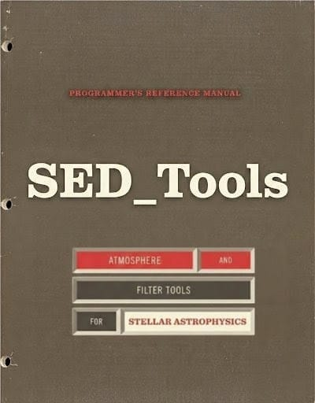

<p align="center">
  
</p>

<h1 align="center">SED_Tools</h1>

<p align="center">
  <strong>Stellar spectral grids and photometric filter curves, ready for MESA and for Python</strong>
</p>

<p align="center">
  <a href="https://github.com/nialljmiller/SED_Tools/actions/workflows/tests.yml"></a>
  <a href="https://pypi.org/project/sed-tools/"></a>
  <a href="https://doi.org/10.5281/zenodo.18321943"></a>
</p>

SED_Tools downloads stellar spectral grids (model spectra indexed by Teff,
log g and [M/H]) and photometric filter transmission curves, converts them to
one set of units, and writes the flux cubes, lookup tables and filter folders
that [MESA](https://docs.mesastar.org/)'s `colors` module and
[SED_Model](https://github.com/nialljmiller/SED_Model) read. The same work is
available from a command line (`sed-tools`) and a Python API.

- **Spectral grids** from the NJM mirror, SVO, MSG and MAST (BOSZ): download all
  or part of a grid, rebuild, combine, densify and interpolate.
- **Filter curves** from the NJM mirror, the instrument teams' own files, or SVO,
  with the detector convention (photon or energy counting) recorded in each file.
- **Optical-path components**: filter, optics, detector QE and the site's
  atmosphere, kept separate where the team publishes them and composed on request.
- **Synthetic photometry**, filter properties and zero points, search and citations;
  **ML tools** that extend incomplete spectra or generate spectra from parameters.

The NJM mirror is optional: without it, SED_Tools uses installed copies, the
original-source builders and SVO.

## Install

```bash
pip install sed-tools                 # Python >= 3.10
pip install "sed-tools[full]"         # adds scipy, scikit-learn, torch, xlrd, dust_extinction
```

Data are stored under `~/.sed_tools/data` by default; `sed-tools config` shows
and changes the location.

## Quick start: command line

```bash
sed-tools                                     # interactive menu
sed-tools filters GAIA/GAIA                   # download a filter set
sed-tools grids --grids Kurucz2003all --teff 4000 8000 --logg 3 5   # part of a grid (about 110 MB)
sed-tools filters-info GAIA/GAIA              # what a filter set contains and where it came from
sed-tools --help                              # every command; `sed-tools <command> --help` for its options
```

## Quick start: Python

```python
from sed_tools.api import SED, Filters

Filters.fetch("GAIA", "GAIA")
SED.fetch("Kurucz2003all", teff_min=4000, teff_max=8000, logg_min=3, logg_max=5)
sed = SED.local("Kurucz2003all/Kurucz2003all_alpha_0p00_lh_1p25_vtur_2_km_s")
mags = sed(teff=5777, logg=4.44, metallicity=0.0).photometry("GAIA", system="AB")
print({name: round(result.magnitude, 2) for name, result in mags.items()})
# Magnitudes of the surface flux (G is about -38.5 for the Sun); scale by (R/d)^2 for a star at distance d.
```

## Using the data in MESA

Every download prints the lines to put in the `&colors` inlist, for example:

```fortran
instrument  = '/home/you/.sed_tools/data/filters/GAIA/GAIA'
stellar_atm = '/home/you/.sed_tools/data/stellar_models/Kurucz2003all/Kurucz2003all_alpha_0p00_lh_1p25_vtur_2_km_s'
```

Paste them as printed: MESA reads the absolute paths, and nothing needs to be
copied into MESA's own data folder. `sed-tools mesa-path PATH` prints them
again for any installed grid or filter set, and `sed-tools vega` downloads the
Vega spectrum MESA uses for Vega magnitudes. A grid split into variants
(Kurucz2003all: [alpha/M] 0 and 0.4) has one folder per variant, and MESA reads
one of them; its top folder is for SED_Tools only (a `flux_cube.bin` there was left by
0.6.0 or earlier: rename it and run `sed-tools rebuild`). Do not copy a whole split grid into
`$MESA_DIR/data/colors_data/stellar_models/`: it mixes its files with MESA's own
Kurucz2003all and replaces MESA's lookup table. See the
[MESA guide](https://github.com/nialljmiller/SED_Tools/blob/main/docs/mesa.md).

## Documentation

| Guide | Contents |
|---|---|
| [Install](https://github.com/nialljmiller/SED_Tools/blob/main/docs/install.md) | Extras, installing from source, the data directory |
| [Quick start](https://github.com/nialljmiller/SED_Tools/blob/main/docs/quickstart.md) | A filter set, part of a grid, a spectrum and its magnitudes, the MESA lines |
| [Spectral grids](https://github.com/nialljmiller/SED_Tools/blob/main/docs/grids.md) | Sources, partial downloads, local grids, split grids and the all-axes cube, rebuild, combine, densify, import, coverage |
| [Filters](https://github.com/nialljmiller/SED_Tools/blob/main/docs/filters.md) | Fetching, storage, detector types, components and atmospheres, composing, combining, `label_check` |
| [Photometry and zero points](https://github.com/nialljmiller/SED_Tools/blob/main/docs/photometry.md) | AB and Vega magnitudes, band integration, filter properties, zero points, display colours |
| [MESA](https://github.com/nialljmiller/SED_Tools/blob/main/docs/mesa.md) | Inlist lines, `mesa-path`, `mesa_prepare`, Vega, what not to copy |
| [Machine learning](https://github.com/nialljmiller/SED_Tools/blob/main/docs/ml.md) | SED completer and generator |
| [Command line](https://github.com/nialljmiller/SED_Tools/blob/main/docs/cli.md) | Every `sed-tools` command, the menu, exit codes |
| [Python API](https://github.com/nialljmiller/SED_Tools/blob/main/docs/python-api.md) | `SED`, `SpectralGrid`, `Spectrum`, `Filters`, examples, the CLI-to-API table |
| [NJM mirror](https://github.com/nialljmiller/SED_Tools/blob/main/docs/njm.md) | What [the mirror](https://data.nialljmiller.com/sed_tools/) serves, its catalogue and cache, working without it |
| [Developing](https://github.com/nialljmiller/SED_Tools/blob/main/docs/developing.md) | Package layout, tests, golden tests, releases |
| [Citing](https://github.com/nialljmiller/SED_Tools/blob/main/docs/citing.md) | SED_Tools, the data providers, `Filters.cite` |
| [Changelog](https://github.com/nialljmiller/SED_Tools/blob/main/docs/source/changelog.rst) | Changes in each release |
| [Notebooks](https://github.com/nialljmiller/SED_Tools/tree/main/jupyter_notebooks) | Worked examples |

## Citation

Please cite the archived release through Zenodo, using the concept DOI, which
covers all versions and resolves to the latest:
[10.5281/zenodo.18321943](https://doi.org/10.5281/zenodo.18321943).

Version 0.6.0: [10.5281/zenodo.24117340](https://doi.org/10.5281/zenodo.24117340)

Metadata are in [`CITATION.cff`](https://github.com/nialljmiller/SED_Tools/blob/main/CITATION.cff).
SED_Tools is the data-preparation pipeline for MESA's `colors` module
([colors/README.rst](https://github.com/MESAHub/mesa/blob/main/colors/README.rst)).
Filter curves and spectra belong to the teams that published them; please cite
them as well. `Filters.cite("GAIA/GAIA")` prints the references and the
acknowledgements each provider asks for.

## Contributing and licence

Bug reports and pull requests are welcome: see
[CONTRIBUTING.md](https://github.com/nialljmiller/SED_Tools/blob/main/CONTRIBUTING.md),
the [Code of Conduct](https://github.com/nialljmiller/SED_Tools/blob/main/CODE_OF_CONDUCT.md)
and the [Security Policy](https://github.com/nialljmiller/SED_Tools/blob/main/SECURITY.md).
Thanks to [@andysantarelli](https://github.com/andysantarelli), [@tianzhijia](https://github.com/tianzhijia)
and [@rhdtownsend](https://github.com/rhdtownsend) for issues and suggestions, and to MESA, the
SVO Filter Profile Service, MAST and Rich Townsend's MSG grids for the data and services used.

Released under the [MIT License](https://github.com/nialljmiller/SED_Tools/blob/main/LICENSE).
