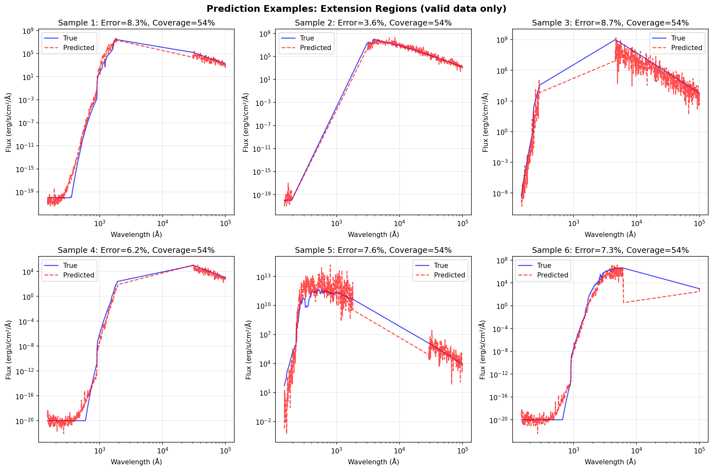
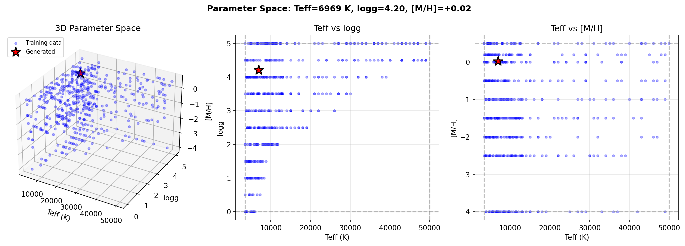
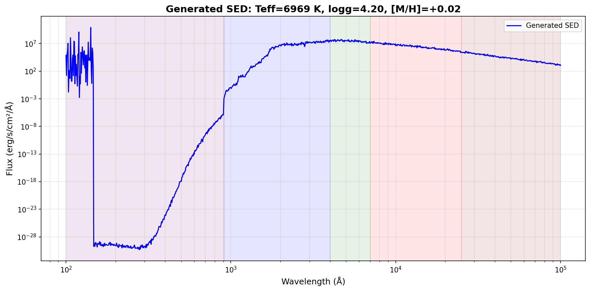

# Machine learning

SED_Tools has two neural-network tools, both of which need the `full` extra
(torch and scikit-learn; see [Install](install.md)):

- the **completer** extends spectra with limited wavelength coverage (for
  example optical only) into the ultraviolet and infrared;
- the **generator** makes a whole spectrum from Teff, log g and [M/H] alone.

Trained models are saved under `~/.sed_tools/data/stellar_models/models/`.
Both tools train on a grid with a 3-axis `flux_cube.bin`: for a split grid,
one variant folder.



## The completer

How it works:

1. it trains on a grid with complete wavelength coverage;
2. a blackbody at each spectrum's Teff is the baseline;
3. the network learns the corrections to that blackbody;
4. masked training handles grids with different wavelength sampling;
5. beyond the input spectrum's range, the prediction is blended into the
   blackbody toward the ends of the requested range.

For a try-out, download an optical-only part of Kurucz2003all into another
folder, train the completer on the full-range variant, and extend the optical
one:

```bash
sed-tools grids --source njm --grids Kurucz2003all --teff 5000 6000 --logg 4 5 \
  --wavelength 3000 10000 --base ~/optical_grids
```

```python
from pathlib import Path
from sed_tools.api import SED

completer = SED.ml_completer()
completer.train(grid="Kurucz2003all/Kurucz2003all_alpha_0p00_lh_1p25_vtur_2_km_s",
                epochs=50, save_name="kurucz_completer")

optical = Path.home() / "optical_grids/Kurucz2003all/Kurucz2003all_alpha_0p00_lh_1p25_vtur_2_km_s"
extended = completer.extend(str(optical), wavelength_range=(1000, 50000),
                            output=str(Path.home() / "optical_grids/Kurucz_extended"))
print(len(extended), extended[0].wavelength.min(), extended[0].wavelength.max())

completer = SED.ml_completer().load("kurucz_completer")     # a saved model, later
```

`train(grid, epochs=100, batch_size=32, save_name=None)` and
`extend(catalog, wavelength_range=None, output=None)` take grid names under
`~/.sed_tools/data/stellar_models/`, or absolute paths as above. `extend`
writes the extended spectra and a lookup table to `output` (default
`<catalog>_extended`) and returns them as a `SpectralGrid`. Spectra that
already cover the range are copied unchanged. The input grid's lookup table
needs Teff, log g and [M/H] columns.

`sed-tools ml_completer` (menu entry 8) offers the same in a terminal:
training, listing the trained models, and extending a grid.

## The generator

How it works:

1. it trains on a flux cube, mapping (Teff, log g, [M/H]) to the whole spectrum;
2. the network learns the spectral shape from those three parameters;
3. log scaling and normalisation handle the flux's dynamic range;
4. `generate_with_outputs` also writes diagnostic plots of the parameter-space
   coverage.

```python
from sed_tools.api import SED, MLGenerator

generator = SED.ml_generator()
generator.train(grid="Kurucz2003all/Kurucz2003all_alpha_0p00_lh_1p25_vtur_2_km_s",
                save_name="sed_generator_Kurucz2003all", epochs=50)

wl, flux = generator.generate(teff=5777, logg=4.44, metallicity=0.0)
wl, flux = generator.generate_with_outputs(teff=5777, logg=4.44, metallicity=0.0,
                                           output_dir="sun_sed")       # .txt and two PNGs

generator = SED.ml_generator().load("sed_generator_Kurucz2003all")
print(generator.parameter_ranges())
print([m["name"] for m in MLGenerator.list_models()])
```

`train(grid, epochs=200, batch_size=64, save_name=None, max_samples=10000)`
saves the model as `models/<save_name>` (default
`sed_generator_<grid>`). Training leaves out spectra whose flux is
non-positive or non-finite anywhere, and says how many; `parameter_ranges()`
then gives the range actually trained on, which can be narrower than the
grid's (for this Kurucz cut it prints a Teff range of 4000–6750 K, not
4000–8000 K). `generate` warns about parameters outside the training ranges
(`check_bounds=False` turns the warning off).





From the command line, `sed-tools ml_generator` (menu entry 9) trains,
generates and lists models in a terminal. `--auto` runs a hyperparameter
search with optuna and then trains the best model; it needs the `ml-tune`
extra as well as `full`:

```bash
sed-tools ml_generator --auto \
  --library ~/.sed_tools/data/stellar_models/Kurucz2003all/Kurucz2003all_alpha_0p00_lh_1p25_vtur_2_km_s \
  --output ~/.sed_tools/data/stellar_models/models/auto --trials 5 --epochs 20
```

`--trials` (default 20) is the number of search trials and `--epochs`
(default 100) the longest final training.

A trained generator also fills Teff gaps in a flux cube: `sed-tools densify
--ml-model ~/.sed_tools/data/stellar_models/models/sed_generator_Kurucz2003all`
(see [Spectral grids](grids.md)).

## Saving generated spectra

`generate` returns two arrays; write them with numpy:

```python
from pathlib import Path
import numpy as np
from sed_tools.api import SED

generator = SED.ml_generator().load("sed_generator_Kurucz2003all")
out = Path("generated")
out.mkdir(exist_ok=True)
stars = [
    {"name": "Sun",      "teff": 5777, "logg": 4.44, "met": 0.0},
    {"name": "HD_cool",  "teff": 4500, "logg": 4.60, "met": -0.5},
]
for star in stars:
    wl, flux = generator.generate(teff=star["teff"], logg=star["logg"], metallicity=star["met"])
    np.savetxt(out / f"{star['name']}.txt", np.column_stack([wl, flux]))
```
